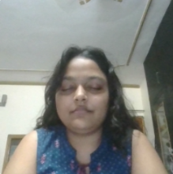
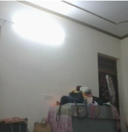
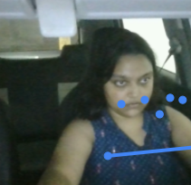
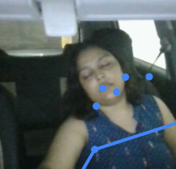
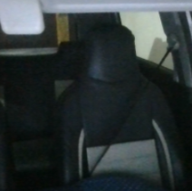

# Doze Alert

A webcam-based sleep detector for students at their desks and for people on long drives. Two machine learning models watch your face and your head position. When either one says you look drowsy for about two seconds, the page sounds a loud alarm and tells you to take a break.

Live site: https://dozealert.vercel.app/
Demo video: _add your video link here_

## Problem statement

Students studying late at night often fall asleep over their books without noticing, losing hours of study time and wrecking their sleep schedule. People driving long distances face the same problem with far more serious consequences. Doze Alert gives a simple warning at the moment it matters, using only a laptop or phone camera.

## Proposed solution

The page reads the webcam, runs an image classification model in the browser, and tracks how long the face stays in a "drowsy" state. If it lasts more than 2 seconds, a full-screen alarm and beeping sound start. The alarm clears when the user looks awake again or presses "I am awake". The page also counts yawns and shows how much of the session you stayed awake.

## Dataset

Self-collected with the webcam in Google Teachable Machine.

**Image model** (eyes and yawns)

| Class | Samples | Description |
|---|---|---|
| Awake |  | Eyes open, looking at the screen, normal blinking |
| Eyes Closed |  | Eyes closed or nearly closed, face toward the camera |
| Yawning |  | Mouth wide open in a yawn |
| Nobody |  | Empty chair or background, no face in frame |

**Pose model** (head and shoulder position)

| Class | Samples | Description |
|---|---|---|
| Awake |  | Upright, head up |
| Drowsy | | Head dropping, nodding off, slumped |
| Nobody |  | Empty chair or background |

Collected by: me. Varied: lighting, distance, angle

## Model training

- Tool: Google Teachable Machine
- Image model: Image Project, standard image model (transfer learning on MobileNet)
- Pose model: Pose Project (PoseNet keypoints, then a small classifier)
- Epochs / batch size / learning rate: 50/16/0.001
- Both exported in TensorFlow.js format (`model/` and `pose-model/`, each with `model.json`, `metadata.json`, `weights.bin`)

## Implementation

- `index.html`, `style.css`, `script.js`, `site.js`: plain HTML, CSS and JavaScript. The page has a landing section, the detector, an about section and contact links, and works on phones (front camera, screen kept awake while checking)
- TensorFlow.js and the Teachable Machine image library loaded from a CDN
- Both models run on every webcam frame. Evidence of drowsiness builds up over time: when both models agree (Eyes Closed and Drowsy above the sensitivity threshold, 80% by default, adjustable) the alarm starts after about 3 seconds; the image model alone needs about 6 seconds; the pose model alone about 10 seconds. This keeps one confused model from setting off the alarm by itself. The evidence drains quickly when you look awake, so normal blinks do not trigger it.
- If the pose model fails to load, the site still works with the image model alone
- The alarm is a loud two-tone siren generated in code and played at full volume, plus a spoken "Wake up!", a full-screen flash, and vibration on supported phones. A "Test alarm sound" button lets users check their volume first
- Video is processed locally and is never uploaded

## Testing

- Tested with my friend in the car
- Result: e.g. correctly detected closed eyes in 7 of 10 attempts
- False alarms: e.g. looking down was counted as closed or drowsy

## Limitations

- Trained on a small, self-collected dataset, so accuracy drops for other faces, glasses, strong backlight, or unusual camera angles
- Looking down at a book may be read as Eyes Closed or Drowsy and cause a false alarm
- A web page cannot raise the device volume or override a muted phone or Do Not Disturb, so the user must turn the volume up (the page reminds them)
- Detects eye and mouth appearance only, not actual sleepiness
- Not a safety device. It must not replace taking breaks or resting before driving

## Credits

- Google Teachable Machine for model training (image and pose)
- TensorFlow.js and @teachablemachine/image libraries
- Fonts: Bricolage Grotesque and IBM Plex Sans (Google Fonts)